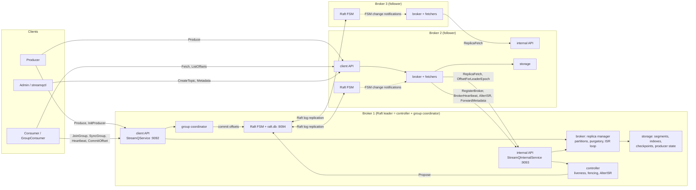

# streamq

streamq is a small Kafka written in Go: a distributed, partitioned, replicated, log-based message
queue. Producers append records to topics, records are routed to partitions by key, and each
partition is an append-only, segmented log on disk. Followers pull each partition from its leader.
A static cluster of brokers keeps its metadata (brokers, topics, partition leaders and ISRs,
committed group offsets, producer-ID blocks) in a Raft log, and the Raft leader acts as the
controller. Consumers read by offset, alone or in consumer groups. The full specification is
[docs/SPEC.md](docs/SPEC.md), every design decision it leaves open is recorded in
[docs/DECISIONS.md](docs/DECISIONS.md), and the internals are drawn in
[docs/ARCHITECTURE.md](docs/ARCHITECTURE.md).

## Features

| Feature | SPEC |
|---|---|
| Segmented append-only log: `.log` + memory-mapped sparse `.index`/`.timeindex`, Kafka-style batch format with CRC-32C, size/time roll, `always`/`interval`/`never` fsync policies | §3.1–3.2, §3.5 |
| Crash recovery from the recovery point: CRC and length validation, truncation of a torn tail, index rebuild | §3.4, FR9 |
| Time- and size-based retention with delayed (`.deleted`) segment removal | §3.2–3.3, FR10 |
| Topics with create/delete/list/describe; keyed partitioning with Kafka's murmur2, sticky partitioner for unkeyed records | §7.1, §7.4, FR1, FR3 |
| Produce with `acks` 0, 1 or `all`; long-poll `Fetch` that never returns data above the high watermark; `ListOffsets` by earliest, latest or timestamp | §4.5, §7.1, FR2, FR4, FR5 |
| Pull replication with LEO/HW tracking, ISR shrink/expand through `AlterISR`, `min.insync.replicas`, an `acks=all` purgatory released on HW change | §4.1–4.3, §4.5, FR8 |
| Leader election from the ISR only (no unclean election), leader epochs, KIP-279 follower truncation through `OffsetForLeaderEpoch` | §4.4 |
| Raft metadata (`hashicorp/raft` + BoltDB) on every broker, controller = Raft leader, broker heartbeats and fencing | §2.1–2.3 |
| Consumer groups: coordinator on the controller, generations, server-side `range`/`roundrobin` assignment, heartbeats, committed offsets in the metadata log | §5, FR6 |
| Idempotent producer: producer IDs in Raft-allocated blocks, per-partition sequences, duplicate detection that survives failover and restart | §6, FR7 |
| Go client library (`pkg/client`): Producer, Consumer, GroupConsumer, Admin, with metadata caching, retries with jittered backoff, batching | §7, FR12 |
| `streamqctl` CLI: topics, produce, consume, groups, `cluster status` | FR11 |
| Controlled shutdown (leadership moves off a stopping broker) and graceful SIGTERM shutdown | §4.6, NFR4 |
| Prometheus metrics, structured JSON `slog` logs, Docker Compose cluster with Prometheus and a Grafana dashboard | NFR6, NFR7 |
| Linearizability checking with porcupine and Docker chaos scenarios | §9 M9 |

## Quick start

Requirements: Go 1.26 (see `go.mod`) and, for the cluster, Docker with Compose.

```sh
make build            # builds ./bin/streamq-broker and ./bin/streamqctl
```

### Single node

[`deploy/single-node.yaml`](deploy/single-node.yaml) runs one broker on `127.0.0.1:9092` with
topic defaults of 3 partitions, RF 1 and `min_insync_replicas` 1, so `acks=all` works with one
broker ([D16](docs/DECISIONS.md#d16-spec-10-defaults-kept-createtopic-doesnt-check-mininsync-against-rf-m2)).
Its data goes to `./data/broker1`, relative to the working directory.

```sh
./bin/streamq-broker --config deploy/single-node.yaml
```

In another terminal:

```sh
./bin/streamqctl topics create demo --partitions 3
printf 'user-1:hello\nuser-2:world\nuser-1:again\n' \
  | ./bin/streamqctl produce --topic demo --key-separator :
./bin/streamqctl consume --topic demo --from-beginning --print-key --print-offset
./bin/streamqctl topics describe demo
```

Metrics are served at <http://localhost:9100/metrics> (the default `metrics_addr` is `:9100`).
The Go examples run against the same broker:

```sh
go run ./examples/producer -topic example -count 1000 -keys 10
go run ./examples/consumer -topic example
go run ./examples/admin
```

### Three-broker cluster

```sh
make cluster-up       # docker compose -f deploy/docker-compose.yml up -d --build
./bin/streamqctl cluster status
./bin/streamqctl topics create orders --partitions 6     # RF 3, min.insync 2 by default
seq 1 1000 | sed 's/^/key-/;s/$/:payload/' \
  | ./bin/streamqctl produce --topic orders --key-separator : --acks all
./bin/streamqctl --bootstrap localhost:9192 consume --topic orders --from-beginning --max-messages 10
./bin/streamqctl topics describe orders
make cluster-down     # stops the cluster and deletes its volumes
```

| Endpoint | Address |
|---|---|
| broker 1, 2, 3 client API | `localhost:9092`, `localhost:9192`, `localhost:9292` |
| Prometheus | <http://localhost:9090> |
| Grafana (anonymous viewer, dashboard "streamq") | <http://localhost:3000> |
| Toxiproxy API (fault injection) | `localhost:8474` |

Broker-to-broker traffic (internal RPCs and Raft) goes through Toxiproxy, so faults can be
injected; client traffic goes straight to the brokers, which advertise `localhost`. Clients inside
the compose network are not supported
([D54](docs/DECISIONS.md#d54-compose-topology-and-shutdown-budget-m8)).

### streamqctl reference

Global flags: `--bootstrap host:port` (default `localhost:9092`) and `--timeout` (per request,
default 10s).

| Command | Notes |
|---|---|
| `topics create NAME [--partitions N] [--replication-factor N] [--config key=value]...` | 0 means the broker's `topic_defaults`; `--config` takes `topic_defaults` keys such as `min_insync_replicas=2` or `retention_ms=3600000` |
| `topics delete NAME`, `topics list`, `topics describe [NAME...]` | `describe` shows leader, epoch, replicas and ISR per partition |
| `produce --topic T [--key-separator S] [--acks none\|leader\|all] [--batch-size N]` | one record per stdin line; text before the first separator is the key |
| `consume --topic T [--partition P] [--offset O \| --from-beginning] [--max-messages N] [--follow] [--print-key] [--print-offset]` | reads up to the high watermark seen at start, or forever with `--follow` |
| `groups list`, `groups describe GROUP`, `groups lag GROUP` | groups are created by applications using `client.GroupConsumer` |
| `cluster status [--strict]` | live brokers, the controller, under-replicated and offline partitions; `--strict` exits non-zero unless healthy |

## Architecture

Every broker runs the same process: a client gRPC API, an internal gRPC API for broker-to-broker
RPCs, a Raft voter for metadata, and the replica manager that owns the partition logs. The Raft
leader is also the controller (broker liveness, leader election, ISR changes, producer-ID blocks)
and the group coordinator. Records never go through Raft: followers pull them from the partition
leader with `ReplicaFetch`.



Package tour:

| Package | Role |
|---|---|
| `internal/record` | batch and record codec (SPEC §3.5): varints, CRC-32C, canonical validation, builder; fuzzed |
| `internal/storage` | segments, mmapped offset and time indexes, `Log` (append, read, roll, truncate, retention), recovery, checkpoints, the per-data-dir `Manager` |
| `internal/partition` | one replica: leader/follower state, LEO/HW, maximal ISR, the leader-epoch cache, the `acks=all` wait, idempotent append |
| `internal/producerstate` | per-partition producer sequence tracking, snapshots and rebuild |
| `internal/broker` | the replica manager: opens partitions from metadata, produce, long-poll fetch, follower fetchers, the ISR loop, producer-ID allocator |
| `internal/metadata` | the `Store` interface and the deterministic FSM state; `local` (single node, `metadata.json`) and `raftstore` (hashicorp/raft) implementations |
| `internal/controller` | broker registration, heartbeats and fencing, AlterISR, controlled shutdown, producer-ID blocks |
| `internal/group` | consumer group coordinator and the `range` and `roundrobin` assignors |
| `internal/server` | thin gRPC handlers; the only place sentinel errors map to API `ErrorCode`s |
| `internal/node` | wires one broker process together and owns its shutdown order |
| `internal/config`, `internal/metrics`, `internal/partitioner` | config loading and validation; the per-node Prometheus registry; Kafka's murmur2 partitioner |
| `pkg/client` | the Go client: `Client`, `Producer`, `Consumer`, `GroupConsumer`, `Admin` |
| `cmd/streamq-broker`, `cmd/streamqctl` | the broker binary and the CLI |

Sequence diagrams (produce with `acks=all`, leader failover with truncation, a group rebalance,
controlled shutdown) and the on-disk layout are in [docs/ARCHITECTURE.md](docs/ARCHITECTURE.md).

## Guarantees

- **Ordering.** Records of one partition are totally ordered by offset. Records with the same key
  go to the same partition (murmur2 of the key modulo the partition count), so per-key order is
  preserved as long as the partition count does not change. The producer keeps one batch in
  flight per partition, so retries cannot reorder batches
  ([D21](docs/DECISIONS.md#d21-at-most-one-in-flight-batch-per-partition-before-idempotence-m3)).
- **Durability with `acks=all`.** The leader rejects the batch with `NOT_ENOUGH_REPLICAS`
  *before* appending if the ISR is smaller than `min.insync.replicas`; otherwise it acknowledges
  only once the high watermark has passed the batch, so every ISR member has it. An `acks=all`
  record is not lost while the ISR has at least `min.insync.replicas` members and at most RF−1
  brokers fail (FR8). "Durable" means replicated to the ISR, not fsynced: with the default
  `flush_policy: interval`, a simultaneous power loss of every replica can lose recent writes, as
  in Kafka. `acks=1` acknowledges after the leader's append and can lose data on failover;
  `acks=0` does not wait at all.
- **Idempotent producer.** With `acks=all` the client is idempotent by default: retries never
  create duplicates and never reorder a partition, across leader failover and broker restarts
  (exactly-once *per partition*, per producer session). Caveat
  ([D48](docs/DECISIONS.md#d48-client-idempotence-m7)): there is no producer-epoch fencing; after
  a batch finally fails the client takes a new producer ID, and a timed-out batch still in flight
  on the server can then land after later batches, which the application was already told had
  failed.
- **Consumers read committed data only.** `Fetch` returns only records below the high watermark,
  so a consumer never sees a record that a leader change could truncate. Followers replicating
  with `ReplicaFetch` read up to the leader's LEO.
- **Consumer groups.** Each partition of a subscribed topic is assigned to exactly one member per
  generation. Commits from a stale generation are rejected with `ILLEGAL_GENERATION`. Committed
  offsets live in the metadata log and survive controller failover. Delivery is at-least-once:
  records processed after the last commit are re-read after a rebalance or restart.
- **No unclean leader election.** If no ISR member is alive the partition goes offline rather
  than losing acknowledged data.

**Not provided** (explicit non-goals): cross-partition transactions, end-to-end exactly-once
processing, authentication and authorization, TLS, a schema registry, log compaction, tiered
storage, compression codecs, dynamic cluster membership (the broker list is static config), and a
from-scratch Raft implementation (`hashicorp/raft` is used for metadata only).

## Testing and correctness

- **Unit tests** in every package, run with `-race` and `goleak` (`make test`). The record decoder
  has a fuzz target (`make fuzz`, `FuzzValidate`), and storage has recovery tests that cut a file
  mid-batch and corrupt CRCs.
- **Integration tests** (`make test-int`, `test/integration`) run real brokers in-process or as
  binaries: 100k keyed records with a restart, client round trips, consumer groups (no double
  assignment, kill and rebalance, stale-generation commits, resume from committed offsets), Raft
  metadata with a controller kill, no acknowledged loss on leader kill, follower rejoin,
  `NOT_ENOUGH_REPLICAS`, the idempotent producer over a lossy network and across failover,
  rolling restart and SIGKILL, controlled shutdown, SIGTERM, and metrics end to end.
- **Linearizability** (`test/linearizability`, also in `make test-int`): a porcupine model of a
  single partition with `acks=all` appends and reads up to the HW, checked on a 3-node in-process
  cluster with 8 leader and follower restarts. Unknown outcomes are open-ended, and durability is
  checked separately against a settled final log
  ([D56](docs/DECISIONS.md#d56-linearizability-model-m9)). Set `STREAMQ_LIN_SEED` to replay a run.
- **Chaos** (`make chaos`, about 11 minutes, needs Docker): six scenarios against the compose
  cluster through Toxiproxy (kill -9 of a random broker, kill -9 of the controller,
  inbound-only isolation, a 20 s `docker pause` of the leader, 200 ± 100 ms latency with
  fragmentation, and a full disk), each with a linearizability workload and an idempotent bulk
  workload.

**Result** ([test/chaos/REPORT.md](test/chaos/REPORT.md)): every scenario passed in every run. No
acknowledged record was lost, the idempotent producer wrote no duplicate, there was no
reordering, phantom or read anomaly, and every history was linearizable under the model.

**Availability caveats** found by the chaos runs:
- An inbound-only network cut of one broker can take the whole cluster down until the cut heals.
  The isolated broker stops hearing Raft heartbeats, wins an election through its working
  outbound links, becomes controller and fences every broker. Safety held; this is accepted and
  documented ([D59](docs/DECISIONS.md#d59-accepted-inbound-only-isolation-can-take-a-cluster-down-m9)),
  as KRaft has the same exposure.
- `acks=all` produce stalls for about 8–10 s after a follower crash, until the follower is
  fenced (9 s session timeout) or shrunk out of the ISR (10 s lag), as in Kafka.
- A full disk leaves its broker as a failing leader until the disk is replaced; there is no
  log-dir failover ([D57](docs/DECISIONS.md#d57-full-disk-behaviour-m9)).
- `docker kill -9` keeps the host page cache, so power-loss durability is not exercised.

## Benchmarks

The load generator is `bench/cmd/streamq-bench`; its flags, presets and output are specified in
[bench/USAGE.md](bench/USAGE.md). By default it starts the brokers inside its own process, with
production timeouts, on loopback
([D60](docs/DECISIONS.md#d60-benchmarks-run-in-process-by-default-m10)).

```sh
make bench    # storage microbenchmarks, then: go run ./bench/cmd/streamq-bench -preset quick

go run ./bench/cmd/streamq-bench -preset nfr1 -json bench/results/nfr1.json          # NFR1
go run ./bench/cmd/streamq-bench -preset nfr1-nonidem -json bench/results/nfr1-nonidem.json
go run ./bench/cmd/streamq-bench -preset nfr2 -json bench/results/nfr2.json          # NFR2

# against the compose cluster (through toxiproxy for broker-to-broker traffic)
go run ./bench/cmd/streamq-bench -bootstrap localhost:9092,localhost:9192,localhost:9292 \
  -acks all -rf 3 -min-insync 2 -duration 30s
```

| Preset | What it measures |
|---|---|
| `quick` | 1 broker, `acks=leader`, 1 KiB, as fast as possible, 10 s (the `make bench` smoke run) |
| `nfr1` | NFR1: 3 brokers, RF 3, `min.insync` 2, `acks=all`, idempotent, 1 KiB, 6 partitions, 8 producers, batch 512 KiB, linger 10 ms, 30 s |
| `nfr1-nonidem` | `nfr1` with idempotence disabled, to show its cost |
| `nfr2` | NFR2: 1 broker, `acks=leader`, 1 KiB at 5,000 msgs/s, linger 1 ms, 30 s; latency from the intended send time |

Explicit flags override preset values. Latency is reported as p50/p99/p999/max; with `-rate`
set it is measured from the token bucket's intended send time, so a stall is not hidden
(coordinated omission; [D61](docs/DECISIONS.md#d61-log-bucket-latency-histogram-m10)). A run
during which any partition's leader epoch or ISR changed is reported `INVALID`.

Read the numbers with these caveats:
- They come from one memory-constrained WSL2 laptop, with every broker and the load generator
  in a single process talking over loopback. That is optimistic compared with a real network and
  separate machines ([D60](docs/DECISIONS.md#d60-benchmarks-run-in-process-by-default-m10)).
- The main throughput constraint is the client's single in-flight batch per partition per
  producer ([D21](docs/DECISIONS.md#d21-at-most-one-in-flight-batch-per-partition-before-idempotence-m3),
  [D48](docs/DECISIONS.md#d48-client-idempotence-m7)): each producer waits for a full `acks=all`
  round trip (leader append, follower fetch, HW advance) per partition before sending the next
  batch. That is why `nfr1` uses large batches and several producers.
- `nfr1` uses `min.insync` 2, as in SPEC §10
  ([D62](docs/DECISIONS.md#d62-nfr1-measured-with-mininsync-2-m10)); `nfr2` uses a 1 ms linger, a
  latency-oriented setting, while the client default is 5 ms
  ([D63](docs/DECISIONS.md#d63-nfr2-linger-m10)).
- Any compose numbers go through Toxiproxy for replication traffic and are labelled as such.

<!-- RESULTS -->

## Design trade-offs

- **Maximal ISR for the HW** ([D45](docs/DECISIONS.md#d45-maximal-isr-m6-kip-497)). The leader
  computes the HW over the committed ISR plus pending additions, and keeps counting members a
  pending shrink would remove (KIP-497). The HW can stall while an AlterISR is outstanding, but it
  never acknowledges data that only an uncommitted ISR holds.
- **KIP-279 truncation** ([D46](docs/DECISIONS.md#d46-kip-279-follower-truncation-m6)). Followers
  find the divergence point with `OffsetForLeaderEpoch` instead of truncating to their HW, so a
  leader change never discards committed data and never keeps divergent data. Truncation deletes
  segments immediately, since followers serve no reads
  ([D39](docs/DECISIONS.md#d39-follower-truncation-deletes-segments-immediately-m6)).
- **`NOT_ENOUGH_REPLICAS` after append** ([D44](docs/DECISIONS.md#d44-not_enough_replicas-after-append-m6)).
  If the ISR shrinks below `min.insync` while an `acks=all` batch waits, the producer gets a
  retriable error although the data may commit; idempotence makes the retry safe.
- **Purgatory on the handler goroutine** ([D43](docs/DECISIONS.md#d43-acksall-purgatory-m6)).
  `acks=all` waits block on HW and leadership-change channels rather than a separate purgatory
  structure: simple and poll-free, at the cost of one parked goroutine per waiting request.
- **One fetcher per followed partition, one RPC per partition** ([D42](docs/DECISIONS.md#d42-replication-concurrency-model-m6)).
  Simpler than Kafka's per-broker fetcher threads with batched requests, but more RPCs with many
  partitions.
- **Idempotence without producer epochs** ([D48](docs/DECISIONS.md#d48-client-idempotence-m7),
  [D49](docs/DECISIONS.md#d49-producer-state-eviction-m7),
  [D50](docs/DECISIONS.md#d50-producer-state-snapshots-m7),
  [D51](docs/DECISIONS.md#d51-producer-id-blocks-m7)). A failed batch makes the client take a new
  producer ID instead of bumping an epoch. Producer state is snapshotted on segment roll and
  rebuilt by replay; IDs come from Raft-allocated blocks of 1000.
- **One batch in flight per partition** ([D21](docs/DECISIONS.md#d21-at-most-one-in-flight-batch-per-partition-before-idempotence-m3)).
  Ordering under retries is trivially correct, but throughput per partition is bounded by the
  round-trip time (see Benchmarks).
- **Server-side group assignment** ([D25](docs/DECISIONS.md#d25-consumer-group-protocol-server-side-assignment-with-kafkas-state-machine-m4)).
  The coordinator runs the assignor and returns each member's assignment from JoinGroup and
  SyncGroup, so clients need no leader-side assignor logic; custom client-side assignors are not
  possible.
- **Controlled shutdown as a controller-applied fence** ([D53](docs/DECISIONS.md#d53-controlled-shutdown-m8)).
  A stopping broker asks the controller to fence it, which reuses the fencing path to elect new
  leaders, then hands off Raft leadership. One shared deadline bounds it, so a missing controller
  never blocks shutdown.
- **Two metadata modes** ([D30](docs/DECISIONS.md#d30-two-metadata-modes-no-migration-m5)). A
  single broker with no `cluster` list uses a local JSON store; cluster mode uses Raft. A data
  dir is never migrated between them.
- **Metrics in an owned registry** ([D52](docs/DECISIONS.md#d52-metrics-m8)). Each node has its
  own Prometheus registry and no global metrics. Per-partition gauges are collected at scrape
  time; ISR size and consumer lag are exported by partition leaders only, and the offline count
  by the controller only. Metric names include `streamq_requests_total`,
  `streamq_request_duration_seconds`, `streamq_partition_high_watermark`,
  `streamq_partitions_under_replicated`, `streamq_consumer_lag` and `streamq_raft_state`.
- **Accepted inbound-isolation weakness** ([D59](docs/DECISIONS.md#d59-accepted-inbound-only-isolation-can-take-a-cluster-down-m9)).
  Safety holds, but an asymmetric cut can make the isolated broker controller and fence everyone.
- **No log-dir failure handling** ([D57](docs/DECISIONS.md#d57-full-disk-behaviour-m9)). A full
  or failed disk makes the log fail sticky; the operator replaces the disk. There is no JBOD
  failover.
- **Delayed deletion without refcounts** ([D7](docs/DECISIONS.md#d7-delayed-deletion-without-reader-refcounts-sticky-io-failure-m1)).
  Retention renames segments to `.deleted` and unlinks them after 60 s instead of tracking
  readers, and a failed fsync makes the log fail permanently until reopened.

## Repository layout

```
api/v1/                   streamq.proto (client API), internal.proto (broker-to-broker RPCs, FSM commands)
gen/v1/                   generated protobuf/gRPC code (make gen; never edited by hand)
cmd/streamq-broker/       broker binary
cmd/streamqctl/           CLI
internal/record/          batch and record encoding, CRC, varints
internal/storage/         segments, indexes, log, retention, recovery, checkpoints
internal/partition/       replica state, LEO/HW, ISR, leader-epoch cache, acks=all wait
internal/producerstate/   idempotence tracking and snapshots
internal/broker/          replica manager: produce, fetch, follower fetchers, ISR loop
internal/metadata/        Store interface and FSM state; local/ and raftstore/ implementations
internal/controller/      broker liveness, fencing, AlterISR, controlled shutdown
internal/group/           consumer group coordinator and assignors
internal/server/          gRPC handlers (validate, delegate, map errors)
internal/node/            process wiring and shutdown order
internal/config/          config loading and validation
internal/metrics/         Prometheus metrics and collectors
internal/partitioner/     Kafka murmur2 partitioner shared by client and CLI
internal/testnode/        in-process broker and cluster helpers for tests
pkg/client/               Go client: Client, Producer, Consumer, GroupConsumer, Admin
examples/                 runnable producer, consumer and admin examples
test/integration/         integration tests (build tag integration)
test/linearizability/     porcupine model, recorder and in-process test
test/chaos/               Docker chaos runner (cmd/chaos) and REPORT.md
bench/                    load generator (cmd/streamq-bench) and USAGE.md
deploy/                   compose cluster, broker configs, Prometheus, Grafana, Toxiproxy
docs/                     SPEC.md, DECISIONS.md, ARCHITECTURE.md, PROGRESS_LOG.md, plans/
Dockerfile                multi-stage image with both binaries (distroless)
```

## Configuration

The broker reads a YAML file (`--config path`). The keys and their defaults are listed in
[SPEC §10](docs/SPEC.md#10-configuration-broker); a full cluster example is
[`deploy/broker1.yaml`](deploy/broker1.yaml). Keys added beyond SPEC §10:

| Key | Default | Meaning |
|---|---|---|
| `controlled_shutdown_timeout_ms` | 30000 | budget for moving leadership off a stopping broker ([D53](docs/DECISIONS.md#d53-controlled-shutdown-m8)); the compose configs use 10000 |
| `log_level` | `info` | `debug`, `info`, `warn` or `error` for the JSON log handler ([D55](docs/DECISIONS.md#d55-log-level-m8)) |
| `group_initial_rebalance_delay_ms` | 3000 | wait for more members before a new group's first rebalance ([D25](docs/DECISIONS.md#d25-consumer-group-protocol-server-side-assignment-with-kafkas-state-machine-m4)) |
| `raft_heartbeat_timeout_ms`, `raft_election_timeout_ms` | 1000, 1000 | Raft timing ([D32](docs/DECISIONS.md#d32-raft-timing-knobs-m5)) |
| `raft_snapshot_threshold` | 8192 | Raft log entries between FSM snapshots |

An empty `cluster` list runs a single node with local metadata; a non-empty list (identical on
every broker) runs Raft. `segment_bytes` must be at most 1 GiB, because the index stores
`uint32` file positions. Configuration is validated at startup and the broker fails fast on an
invalid value.

Precedence is **flags > environment > file > defaults**:
- environment: `STREAMQ_<UPPER_SNAKE_KEY>`, for example `STREAMQ_LOG_LEVEL=debug` or
  `STREAMQ_TOPIC_DEFAULTS_PARTITIONS=6`;
- flags: one per scalar key, with `_` replaced by `-`, for example `--log-level debug` or
  `--topic-defaults.partitions 6`.

The `cluster` list can only be set in the file.

## Development

| Command | What it does |
|---|---|
| `make tools` | installs pinned buf, golangci-lint, protoc-gen-go and protoc-gen-go-grpc into `.tools/bin` |
| `make gen` | `buf lint` and `buf generate` (regenerates `gen/`) |
| `make build` | builds `./bin/streamq-broker` and `./bin/streamqctl` |
| `make test` | `go test -race -count=1 ./...` |
| `make test-int` | integration, linearizability and bench tests (`-tags=integration`) |
| `make lint` / `make fmt` | `golangci-lint run` / `golangci-lint fmt` |
| `make fuzz` | 30 s fuzzing of record decoding |
| `make bench` | storage microbenchmarks and the `quick` bench preset |
| `make cluster-up` / `make cluster-down` | start or stop (and wipe) the compose cluster |
| `make chaos` | builds, then runs the chaos scenarios; results go to `test/chaos/results` |
| `make clean` | removes `bin/` |

Conventions (context first, sentinel errors mapped only in `internal/server`, no globals, owned
goroutines, `goleak` in every test package) are in [CLAUDE.md](CLAUDE.md). Progress and known
limitations per milestone are in [docs/PROGRESS_LOG.md](docs/PROGRESS_LOG.md).
