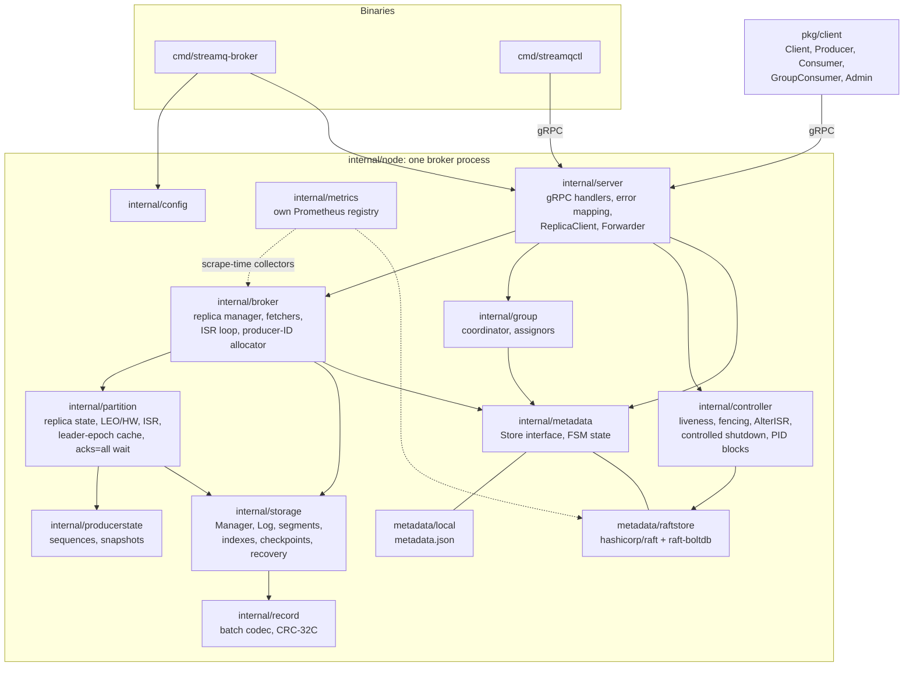
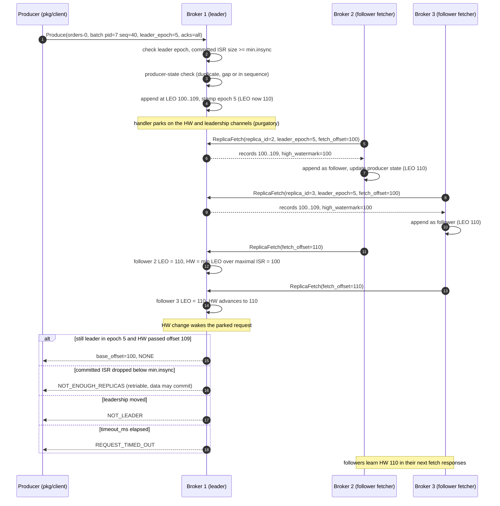
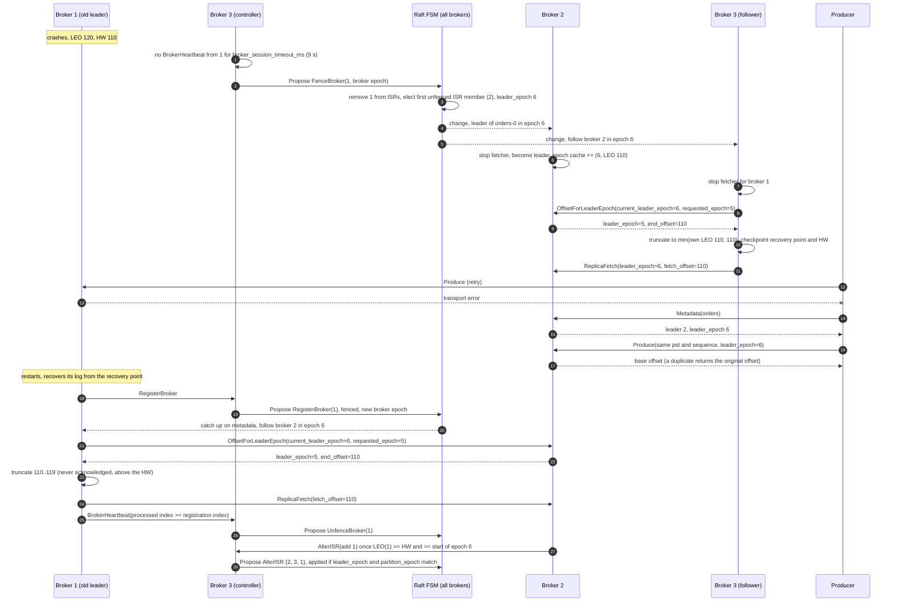
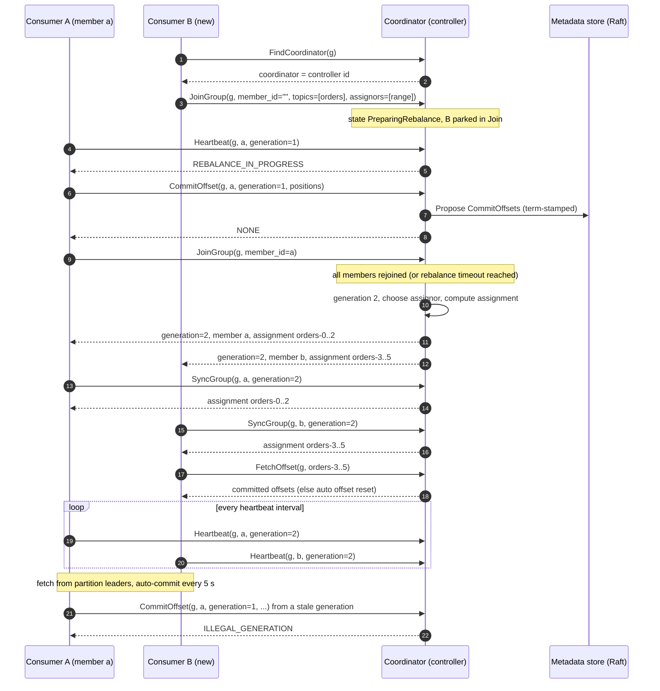
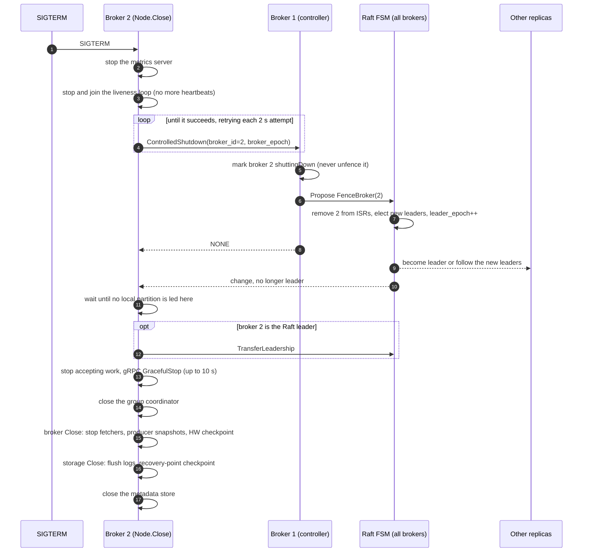

# streamq architecture

This document shows how the pieces of a broker fit together and how the main flows run. The
rules behind each flow are in [SPEC.md](SPEC.md) (section numbers below) and
[DECISIONS.md](DECISIONS.md) (D-numbers). The overview diagram and quick start are in the
[README](../README.md).

- [Components and packages](#components-and-packages)
- [Produce with acks=all](#produce-with-acksall)
- [Leader failover and KIP-279 truncation](#leader-failover-and-kip-279-truncation)
- [Consumer group rebalance](#consumer-group-rebalance)
- [Controlled shutdown](#controlled-shutdown)
- [On-disk layout](#on-disk-layout)

## Components and packages

A broker process (`internal/node`) runs three listeners:

| Listener | Config key | Serves |
|---|---|---|
| client gRPC | `listen_addr` (`:9092`) | `StreamQService` (`api/v1/streamq.proto`): topics, metadata, produce, fetch, offsets, groups |
| internal gRPC | `internal_addr` (`:9093`) | `StreamQInternalService` (`api/v1/internal.proto`): RegisterBroker, BrokerHeartbeat, ForwardMetadata, ReplicaFetch, OffsetForLeaderEpoch, AlterISR, AllocateProducerIDs, ControlledShutdown |
| Raft transport | `raft_addr` (`:9094`) | hashicorp/raft TCP transport (metadata only) |

plus an HTTP `/metrics` endpoint on `metrics_addr` (`:9100`). In single-node mode (empty
`cluster`) there is no internal API and no Raft; metadata lives in a local JSON store
([D30](DECISIONS.md#d30-two-metadata-modes-no-migration-m5)).

Arrows point from caller to callee.



Responsibilities, from the bottom up:

- **`internal/record`** encodes and validates batches (SPEC §3.5); on-disk bytes equal wire bytes.
- **`internal/storage`** owns files: segments with an atomically published size so reads are
  lock-free, mmapped indexes, roll, retention with delayed delete, follower truncation, recovery,
  and the per-data-dir `Manager` with its background flush, retention and checkpoint passes.
- **`internal/partition`** is one replica. As leader it checks leader epochs and `min.insync`,
  runs producer-state checks before appending, tracks follower LEOs, computes the HW over the
  maximal ISR ([D45](DECISIONS.md#d45-maximal-isr-m6-kip-497)) and parks `acks=all` requests
  until the HW passes them ([D43](DECISIONS.md#d43-acksall-purgatory-m6)). As follower it
  appends fetched batches and keeps HW = min(leader HW, own LEO)
  ([D40](DECISIONS.md#d40-high-watermark-rules-m6)).
- **`internal/broker`** subscribes to metadata changes and turns them into leader/follower
  transitions. It runs one fetcher goroutine per followed partition and one ISR loop
  ([D42](DECISIONS.md#d42-replication-concurrency-model-m6)), serves produce, long-poll fetch,
  ListOffsets and the leader side of ReplicaFetch and OffsetForLeaderEpoch.
- **`internal/metadata`** defines `Store` (reads, `Subscribe`, `Propose`) and the deterministic
  FSM state: brokers, topics, partitions (`replicas`, `leader`, `leader_epoch`, `isr`,
  `partition_epoch`), group offsets and producer-ID blocks. `local` and `raftstore` implement it.
- **`internal/controller`** acts only on the Raft leader: it registers brokers, fences them after
  `broker_session_timeout_ms` without a heartbeat, unfences them once caught up
  ([D34](DECISIONS.md#d34-fencing-semantics-m5), [D35](DECISIONS.md#d35-registration-and-catch-up-m5)),
  applies AlterISR, allocates producer-ID blocks and handles controlled shutdown. Its commands
  carry the Raft term they were issued in, so a deposed controller can never write
  ([D33](DECISIONS.md#d33-forwarding-and-leader-only-writes-m5)).
- **`internal/group`** is the consumer group coordinator, running on the controller.
- **`internal/server`** is a thin gRPC layer: validate, delegate, and map sentinel errors to
  `ErrorCode`s in one table.

## Produce with acks=all

SPEC §4.2, §4.5; [D43](DECISIONS.md#d43-acksall-purgatory-m6),
[D44](DECISIONS.md#d44-not_enough_replicas-after-append-m6),
[D45](DECISIONS.md#d45-maximal-isr-m6-kip-497). Partition `orders-0` has replicas {1, 2, 3},
leader 1 in epoch 5, ISR {1, 2, 3} and `min.insync.replicas` 2.



Points to note:
- If the committed ISR is already below `min.insync.replicas`, step 2 returns
  `NOT_ENOUGH_REPLICAS` and nothing is appended.
- A duplicate idempotent batch is not appended again: the leader returns the original offsets,
  and the response still waits for the HW like any other `acks=all` batch.
- Consumers' `Fetch` reads only below the HW; `ReplicaFetch` reads up to the leader's LEO.
- A lagging follower stays in the ISR until it has not caught up for `replica_lag_max_ms`; the
  leader then sends AlterISR to the controller and keeps counting it towards the HW until the
  shrink is committed ([D41](DECISIONS.md#d41-isr-expansion-rule-m6),
  [D45](DECISIONS.md#d45-maximal-isr-m6-kip-497)).

## Leader failover and KIP-279 truncation

SPEC §2.3, §4.4; [D34](DECISIONS.md#d34-fencing-semantics-m5),
[D35](DECISIONS.md#d35-registration-and-catch-up-m5),
[D46](DECISIONS.md#d46-kip-279-follower-truncation-m6). Broker 1 leads `orders-0` in epoch 5 and
crashes with records at offsets 110..119 that only it has. Broker 3 is the controller.



The truncation loop handles more cases than this one ([D46](DECISIONS.md#d46-kip-279-follower-truncation-m6)):
if the leader only knows an older epoch, the follower truncates to its own end of that epoch and
asks again; without epoch information on either side it falls back to its HW; below the leader's
log start it restarts empty at the leader's log start. Truncation makes the lowered recovery
point and HW durable before the next append. Followers truncate whole segments immediately
([D39](DECISIONS.md#d39-follower-truncation-deletes-segments-immediately-m6)).

If no ISR member is alive, the partition gets leader -1 (offline) and stays so until an ISR
member returns; there is no unclean election. Any request carrying an older `leader_epoch` gets
`FENCED_LEADER_EPOCH`.

## Consumer group rebalance

SPEC §5; [D25](DECISIONS.md#d25-consumer-group-protocol-server-side-assignment-with-kafkas-state-machine-m4).
Consumer A is the only member of group `g` (generation 1, all partitions of `orders`); consumer
B joins. The coordinator is the controller. Assignment is computed by the coordinator, not by a
group leader, and `JoinGroup` blocks until the rebalance completes.



- A member whose heartbeats stop for longer than its session timeout, or that sends
  `LeaveGroup`, triggers the next rebalance.
- A new group waits `group_initial_rebalance_delay_ms` (3 s) for more members before its first
  rebalance.
- Membership is held in memory on the coordinator; committed offsets are in the metadata store.
  After a controller failover, members get `NOT_COORDINATOR` or `UNKNOWN_MEMBER_ID`, find the new
  coordinator and rejoin.

## Controlled shutdown

SPEC §4.6, NFR4; [D53](DECISIONS.md#d53-controlled-shutdown-m8). Broker 2 receives SIGTERM while
leading some partitions; broker 1 is the controller. Steps 2–6 share one deadline,
`controlled_shutdown_timeout_ms` (default 30 s).



- The request is skipped once no controller has been visible for twice the Raft election
  timeout, because without a quorum nothing can move.
- Failures only log: shutdown never blocks beyond the deadline.
- A heartbeat already in flight to a newly elected controller can briefly unfence the stopping
  broker; it self-heals by the session timeout.
- In compose the budget is 10 s and `stop_grace_period` is 30 s
  ([D54](DECISIONS.md#d54-compose-topology-and-shutdown-budget-m8)).

## On-disk layout

SPEC §3.1; [D17](DECISIONS.md#d17-topic-ids-partitionmetadata-and-stray-dir-cleanup-m2-on-disk-addition-approved-by-the-plan-reviewer),
[D30](DECISIONS.md#d30-two-metadata-modes-no-migration-m5),
[D37](DECISIONS.md#d37-on-disk-additions-and-go-hclog-m5-approved-by-the-plan-reviewer),
[D50](DECISIONS.md#d50-producer-state-snapshots-m7).

```
<data_dir>/
├── recovery-point-offset-checkpoint     last flushed offset per partition
├── replication-offset-checkpoint        high watermark per partition (every 5 s and on shutdown)
├── metadata.json                        single-node mode only: local metadata store
├── raft/                                cluster mode only
│   ├── raft.db                          BoltDB Raft log and stable store
│   └── snapshots/                       FSM snapshots (versioned JSON)
└── orders-0/                            one directory per partition: <topic>-<partition>
    ├── partition.metadata               "version: 0" and the topic id
    ├── leader-epoch-checkpoint          "epoch startOffset" lines
    ├── 00000000000000000000.log         record batches; file name = base offset (20 digits)
    ├── 00000000000000000000.index       sparse offset index (relative offset, position)
    ├── 00000000000000000000.timeindex   time index (timestamp, relative offset)
    ├── 00000000000000052311.snapshot    producer state up to offset 52311 (written on roll)
    ├── 00000000000000052311.log         the active segment
    ├── 00000000000000052311.index
    └── 00000000000000052311.timeindex
```

- **Checkpoint files** use Kafka's text format: a version line (`0`), an entry count, then one
  entry per line (`topic partition offset`, or `epoch startOffset`). They are written to a
  `.tmp` file, fsynced, renamed over the old file, and the directory is fsynced.
- **Indexes** are memory-mapped, preallocated and trimmed on roll. Offset index entries are 8
  bytes (`uint32` relative offset, `uint32` position), so a segment is at most 1 GiB; time index
  entries are 12 bytes ([D3](DECISIONS.md#d3-index-file-format-and-validity-m1)). Indexes of
  segments at or after the recovery point are rebuilt from the log on startup.
- **Producer snapshots** (`<offset>.snapshot`, a CRC32C plus a JSON body) cover every batch below
  their offset. They are written on segment roll and at the LEO on clean shutdown; recovery loads
  the newest valid one and replays later batches.
- **Deleted segments** are renamed with a `.deleted` suffix and unlinked after
  `file_delete_delay_ms` (60 s); leftovers are removed at startup
  ([D7](DECISIONS.md#d7-delayed-deletion-without-reader-refcounts-sticky-io-failure-m1)).
  Deleted topics and stray partition directories are renamed `<dir>.<id|stray>.<random>.delete`
  and removed in the background.
- **Mode guard:** a broker refuses to start in one metadata mode when the other mode's metadata
  (`metadata.json` or `raft/`) is present
  ([D30](DECISIONS.md#d30-two-metadata-modes-no-migration-m5)).
